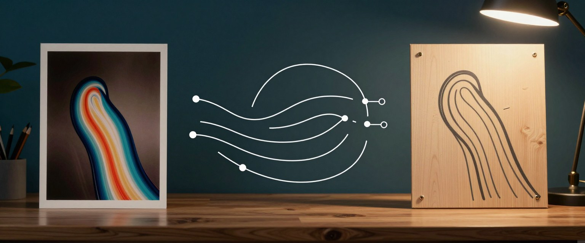

# photowright



An agent plugin for Photoshop-like work on images you already have, and for tracing them to vectors. It runs free tools first and its own code before those. Photoshop is never required.

photowright is one skill for AI coding agents plus a command-line tool, `phw.py`, that needs Python with Pillow and NumPy. OpenCV, SciPy, scikit-image, VTracer, Inkscape and GIMP are used when they are installed and reported when they are not.

## What it does

- **Adjust**: levels, curves, exposure, white balance, hue and saturation, LUTs, black and white, Camera Raw sliders (fitted to a reference photo's look with `camraw --match`), crop, straighten, resize in linear light, sharpen, denoise, format, bit depth and colour profile.
- **Select and cut out**: colour, luma, edge and flood selections, mask editing, background removal (GrabCut or colour key).
- **Retouch**: spot heal, clone stamp, object removal and content-aware fill, red eye, dust and scratches, old-photo pass.
- **Transform and merge**: mesh warp, perspective correction, upscale, exposure fusion and focus stacks, panorama stitch.
- **Layers**: composite a layer recipe with blend modes, masks, clipping, text, shapes and shadows; read and write PSD and ORA.
- **Batch**: one recipe over a folder, a dry run until `--apply`, never overwriting; before/after sheets, diffs, and drift across several edit rounds (`drift`).
- **Trace to vectors**: logos, icons, line art, photos, pixel art and centrelines to SVG, checked by rendering the SVG back against the source; simplify; export SVG, PDF, EPS or DXF (millimetres for laser and vinyl cutters).

Every edit is a step in a recipe that `phw.py run` replays, and every result says which tool did each step and at which rung: own code (1), free tools (2), local models (3).

## Install

```
claude plugin marketplace add m4bwav/photowright
claude plugin install photowright@photowright
```

Then check the tools from a clone with `python scripts/phw.py doctor`; in an installed plugin the script is under the plugin root (`${CLAUDE_PLUGIN_ROOT}/scripts/phw.py doctor`).

## Not for

Critiquing or ranking images (artwright), pixel art and sprites (pixelwright), brand marks made from nothing (brandwright), or generating new images (comfyui-gen).

## Tests

`python -m unittest discover -s tests` (run it again with `PHW_RUNG_MAX=1` to test own code alone). Skill evals: `python evals/run.py`, results in [TESTS.md](TESTS.md).

## Licence

MIT. Copyleft tools (GIMP, Inkscape, Potrace) are called as separate programs, never bundled.
